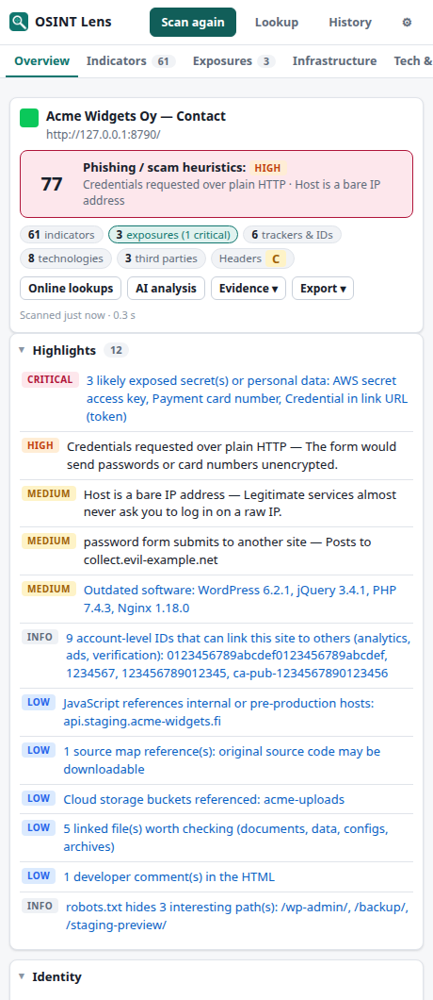
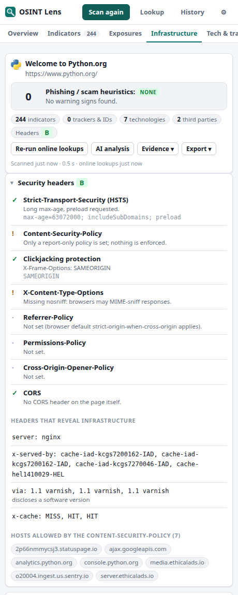
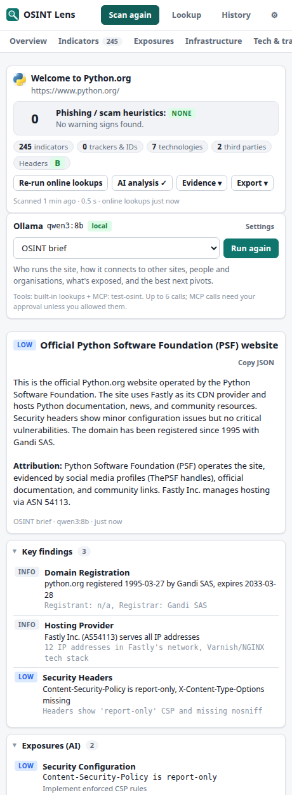
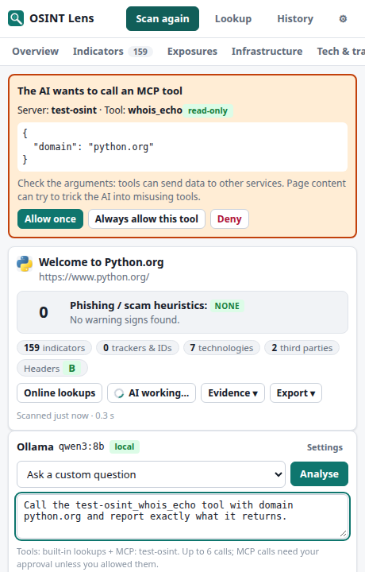

<p align="center"></p>

<h1 align="center">OSINT Lens</h1>

<p align="center">
  An open-source investigation workbench for web pages, built as a Chrome extension.<br>
  It finds identifiers, infrastructure, trackers, metadata and exposed data, and triages phishing.<br>
  AI analysis runs locally through <b>Ollama</b> (or any OpenAI-compatible server, or Anthropic), and any <b>MCP server</b> can be connected for extra tools.
</p>

<p align="center">
  <a href="#install">Install</a> ·
  <a href="#what-it-finds">What it finds</a> ·
  <a href="#ai-analysis">AI</a> ·
  <a href="#mcp-servers">MCP</a> ·
  <a href="docs/FEATURES.md">Feature guide</a> ·
  <a href="docs/HOW_IT_WORKS.md">How it works</a> ·
  <a href="docs/PRIVACY.md">Privacy</a>
</p>

<p align="center">
  
  
  
  
</p>

---

## Why

Most of what you need to investigate a website is already on the page or one public lookup away. The analytics account that links it to the owner's other sites. The registrant and hosting. The author's name in a PDF's metadata. The GPS position in a photo. The staging server named in a JavaScript bundle. The login form that posts to somebody else's server. OSINT Lens collects all of it with one click, explains it, and gives you a pivot link for every identifier. Everything is kept locally so that sites that share an identifier are linked across your investigations.

It's built to be trustworthy. There is no backend and no telemetry, and the page's own scripts can't see or influence the scan. Nothing goes to a third party unless you run an online lookup, a cloud AI or an MCP tool, and the UI tells you when you do.

## Install

**From a release:** download `osint-lens-<version>.zip` from [Releases](../../releases) and unzip it somewhere permanent.
**From source:** clone this repository. There is no build step.

1. Open `chrome://extensions` and turn on **Developer mode** (top right).
2. Click **Load unpacked** and choose the folder that contains `manifest.json`.
3. Pin **OSINT Lens** from the puzzle-piece menu.
4. On any page, click the icon (or press <kbd>Alt</kbd>+<kbd>Shift</kbd>+<kbd>O</kbd>) to open the side panel, then click **Scan page** (<kbd>Alt</kbd>+<kbd>Shift</kbd>+<kbd>S</kbd>).

It works in Chrome, Edge, Brave and other Chromium browsers, version 120 or newer.

> **Site access.** Clicking the toolbar icon gives the extension temporary access to that one tab. If you want to scan any tab from the side panel without clicking the icon each time, use **Settings → Privacy & data → Allow on all sites**. This permission is optional and can be revoked.

## What it finds

| Area | Details |
|---|---|
| **Identifiers** | Emails (including `name [at] domain [dot] com` style obfuscation), phone numbers, 60+ social and messaging platforms, crypto wallets with checksum validation (BTC, ETH, LTC, DOGE, TRX, XMR, ADA…), IPv4/IPv6, Tor/I2P services, coordinates (decimal, DMS and map links), IBANs, business and VAT IDs, CVEs, file hashes, @handles |
| **Account-level IDs** | Google Analytics 4 / UA, Tag Manager, Ads, AdSense publisher, Meta Pixel, TikTok, LinkedIn, Hotjar, Clarity, Yandex Metrica, Matomo, Segment, Mixpanel, Sentry org/DSN, Intercom, HubSpot, Shopify store, Stripe, Mapbox, Algolia, Firebase, Auth0/Okta/Cognito tenants: 70+ ID types in total. Also site-verification tokens (Google, Bing, Meta, Apple, Atlassian…) and `ads.txt` seller accounts. These belong to the *owner* and are the best way to find their other sites. |
| **Identity** | Structured data (JSON-LD organisations, people, addresses, `sameAs` profiles), `rel=me`, meta authors, registrant details (RDAP), names in document metadata |
| **Exposures** | Private keys, cloud and SaaS tokens (AWS, GCP, Azure, GitHub, GitLab, Slack, Stripe, OpenAI, Anthropic, SendGrid, npm…), database URLs with passwords, hard-coded passwords, JWTs (decoded), credentials in link URLs, payment cards (Luhn), IBANs, US SSNs, Finnish personal IDs. All are checksum-validated where the format allows. |
| **Technology** | 140+ fingerprints (CMS, frameworks, libraries, servers, CDNs, WAFs, hosting) with versions. Known-vulnerable versions (jQuery, Bootstrap, AngularJS, Lodash, Next.js…) are flagged. |
| **Infrastructure** | Security-header grade and leaks, every third-party host by category, CSP-allowed hosts, cookies, storage keys, JavaScript runtime config |
| **JavaScript** | API endpoints, cloud buckets (S3, GCS, Azure, R2…), internal and pre-production hostnames, source maps, build-time env variables, developer comments |
| **Site files** | `robots.txt` (interesting paths), `sitemap.xml`, `security.txt`, `humans.txt`, `ads.txt` / `app-ads.txt`, web-app manifest, favicon hash (Shodan MurmurHash3, MD5, SHA-256) |
| **Phishing triage** | 30+ explained signals: punycode homographs, lookalike/typo domains, brand impersonation in host or title, forms posting to other sites or to Telegram/Discord/webhooks, credentials over HTTP, seed-phrase requests, wallet drainers, ClickFix paste-a-command lures, obfuscated JS, domain age |
| **File metadata** | EXIF (GPS, camera serial, owner), XMP (document IDs, edit history), IPTC from JPEG/PNG/WebP/TIFF. Author, user names, company, file-server paths, tracked-change authors, hidden sheets and macros from PDF, DOCX/XLSX/PPTX and ODF. |

### Online lookups (optional, one click)

DNS over HTTPS, mail security (SPF, DMARC, MTA-STS), RDAP registration and domain age, IP owner, ASN and hosting (Team Cymru), open ports and CVEs (Shodan InternetDB), subdomains from certificate transparency (crt.sh, Cert Spotter as fallback), Wayback Machine history including archived documents, earlier public scans (urlscan.io), and the contents of Google Tag Manager containers. None of these need an API key. The target site itself isn't contacted.

### Investigation tools

- **Pivot links** for every indicator: Shodan, Censys, VirusTotal, urlscan, crt.sh, SecurityTrails, BuiltWith, DNSlytics, PublicWWW, blockchain explorers, map services and many more.
- **Correlation**: every scan is indexed locally. When a new site shares an analytics ID, wallet, email or favicon with an earlier one, the Overview shows the link and the relationship graph draws it.
- **Lookup**: paste any value, or right-click selected text, a link or an image → *Investigate*.
- **Highlight on page**: jump to every place a finding appears.
- **Evidence**: visible-area screenshots and full-page MHTML archives, each with a SHA-256 hash.
- **Export**: Markdown report, full JSON, CSV indicators, and a **STIX 2.1** bundle for OpenCTI or MISP.
- **History** with notes, tags, stars and search across all indicators.

## AI analysis

The model gets a compact digest of everything the scan found, plus the page text, and returns a structured brief: verdict, risk, summary, attribution, key findings, entities, exposures and suggested pivots. You can then ask follow-up questions. There are three modes (**OSINT brief**, **Phishing triage**, **Data exposure audit**) and custom questions.

| Provider | Notes |
|---|---|
| **Ollama** (default) | Fully local. Use a model with tool calling, e.g. `ollama pull qwen3:8b`. Thinking is on by default because it makes small models much better at using tools. |
| **OpenAI-compatible** | LM Studio, llama.cpp server, vLLM, LocalAI, Jan, OpenRouter, OpenAI… |
| **Anthropic** | Messages API with your own key |

**Tools.** The model can call built-in lookups (DNS, RDAP, ASN, open ports, certificate transparency, archive history, urlscan) and the tools of every MCP server you allow. It can also read report sections and search the page text. MCP calls need your approval in the panel unless you've chosen otherwise.

**Safety.** Page content and tool results are marked as untrusted data and the model is told never to follow instructions inside them. When the provider isn't on your computer, secrets are masked in what's sent. The approval prompt always shows the exact arguments.

If Ollama returns *403*, see [Troubleshooting](docs/HOW_IT_WORKS.md#troubleshooting). Recent Ollama versions accept extension requests by default.

## MCP servers

Any [Model Context Protocol](https://modelcontextprotocol.io) server can be connected in **Settings → MCP servers**: threat-intel services, search engines, a headless browser, your case-management system, a database. Once connected you can:

- run any tool by hand from the **MCP** tab. A form is generated from the tool's schema, with values from the page suggested.
- save a call as a **recipe** with placeholders (`{domain}`, `{url}`, `{ip}`, `{email}`…) and run it on any page, or automatically after every scan.
- let the **AI** use the tools during its analysis, with per-server approval policies: ask every time, auto-approve read-only tools, or trusted.

**Transports.** The client auto-detects the 2026-07-28 stateless Streamable HTTP protocol, the 2025 Streamable HTTP handshake with sessions, and the legacy HTTP+SSE transport. You can add custom headers for bearer tokens or API keys.

**Local stdio servers** (the ones you run with `npx`, `uvx` or `docker`) are reached through the bundled zero-dependency bridge:

```bash
node tools/mcp-bridge.mjs -- npx -y @modelcontextprotocol/server-everything
```

```bash
node tools/mcp-bridge.mjs --config mcp-servers.json
```

The second form takes the Claude Desktop config format and serves each server at `http://127.0.0.1:8765/<name>/mcp`. The bridge listens only on localhost, requires a bearer token, and rejects requests from web pages and from DNS-rebinding attempts. See [docs/MCP.md](docs/MCP.md).

## Privacy in one paragraph

A scan reads the page in your browser. It also requests the site's public files (`robots.txt`, `security.txt`…) and its script files, much as a normal visitor's browser would. Reports are stored in your browser's local database and nowhere else. Online lookups send the domain and its IPs to the public services listed above. Cloud AI providers receive the digest with secrets masked. MCP servers receive the arguments you approve. Password field values are never read. Full details are in [docs/PRIVACY.md](docs/PRIVACY.md).

## Development

```bash
npm test            # unit tests: analysis, MCP transports and bridge, AI agent loop (no network needed)
```

```bash
npm run check       # manifest, imports, syntax
```

```bash
npm install && npm run test:e2e   # loads the extension into Chrome and scans a fixture site
```

```bash
npm run package     # dist/osint-lens-<version>.zip
```

There is no bundler and no runtime dependencies. The code is plain ES modules that Chrome loads directly. `src/core` is pure, testable analysis. `src/intel` holds the online sources, `src/mcp` the MCP client, `src/ai` the providers and agent, `src/background` the service worker, and `src/ui` the side panel and settings. Every feature, with security notes, is described in [docs/FEATURES.md](docs/FEATURES.md); the architecture is in [docs/HOW_IT_WORKS.md](docs/HOW_IT_WORKS.md), and [docs/RESEARCH.md](docs/RESEARCH.md) explains why each feature exists. Contributions are welcome: see [CONTRIBUTING.md](CONTRIBUTING.md).

## Responsible use

OSINT Lens reads what a page already shows any visitor and queries public sources. It does not probe for hidden paths, brute-force anything or bypass access controls. Investigate only what you are entitled to, respect the terms of the services you query, follow the law where you are, and treat heuristic results as leads to verify, not conclusions.

## Support

OSINT Lens is free and open source. If it saves you time, you can [buy me a coffee](https://buymeacoffee.com/marginnotes).

## License

[MIT](LICENSE)
