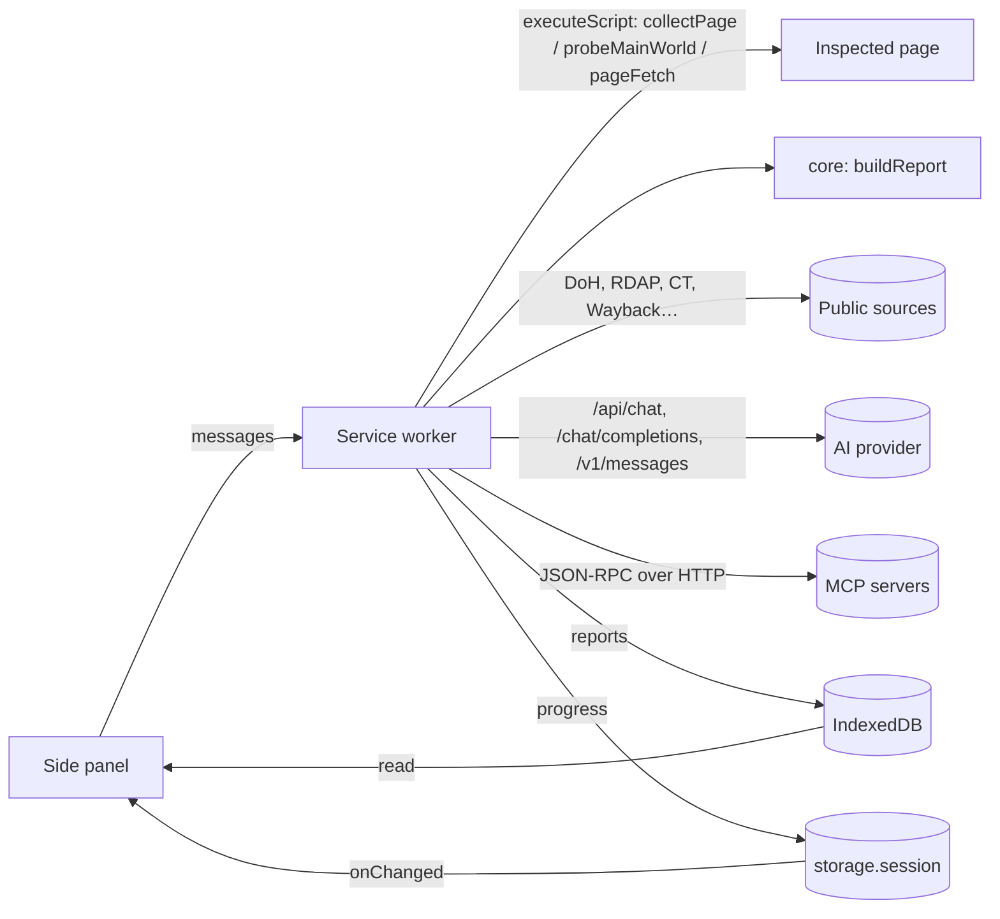

# OSINT Lens: how it works

This document explains the architecture, what happens during a scan, how each analysis works, and how to extend it. For what data goes where, see [PRIVACY.md](PRIVACY.md). For MCP specifics, see [MCP.md](MCP.md).

## Contents

1. [Architecture](#1-architecture)
2. [The scan, step by step](#2-the-scan-step-by-step)
3. [Analysis modules](#3-analysis-modules)
4. [Online lookups](#4-online-lookups)
5. [AI analysis](#5-ai-analysis)
6. [MCP integration](#6-mcp-integration)
7. [Storage, history and correlation](#7-storage-history-and-correlation)
8. [The side panel](#8-the-side-panel)
9. [Permissions](#9-permissions)
10. [Extending](#10-extending)
11. [Testing](#11-testing)
12. [Troubleshooting](#troubleshooting)
13. [Limitations](#13-limitations)

---

## 1. Architecture

```
manifest.json
src/
  core/        Pure analysis (no chrome.*, no network): unit-tested in Node
    analyze.js      builds the report from collected page data
    entities.js     emails, phones, wallets, IPs, coordinates, IDs…
    exposures.js    secrets and personal-data detectors (+ JWT decoding)
    trackers.js     analytics/ad/account IDs and verification tokens
    tech.js         technology fingerprints and vulnerable versions
    headers.js      security headers, CSP hosts, infrastructure leaks
    links.js        link categories, credentials in URLs, third-party map
    phishing.js     explained phishing/scam signals and score
    jsintel.js      endpoints, buckets, internal hosts, source maps, env vars
    wellknown.js    robots.txt, sitemap, security.txt, ads.txt, manifest
    favicon.js      MurmurHash3 (Shodan), MD5, SHA-256
    exif.js         EXIF/GPS, XMP, IPTC (JPEG, PNG, WebP, TIFF)
    docmeta.js      PDF, OOXML and ODF metadata (+ zip.js)
    pivots.js       pivot-link templates per indicator type
    export.js       Markdown, JSON, CSV, STIX 2.1
    domain.js       registrable domain, punycode, IP classes, lookalikes
    validators.js   Luhn, IBAN, HETU, Base58Check, Bech32, SHA-256…
  content/     Functions injected into the inspected page
    collect.js      collectPage (isolated world), probeMainWorld (main world), pageFetch
    highlight.js    on-page highlighting
  intel/       Online sources: DoH, RDAP, CT, Wayback, InternetDB, Cymru, urlscan, GTM
  mcp/         MCP client (3 transports), SSE parser, server registry
  ai/          Providers (Ollama, OpenAI-compatible, Anthropic), prompts, tools, agent loop
  background/  Service worker: message router, scan pipeline, jobs, state
  shared/      Settings and IndexedDB storage
  ui/          Side panel, tabs, settings page, welcome page
tools/mcp-bridge.mjs   stdio → HTTP bridge for local MCP servers
```



All long-running work happens in the **service worker**, so closing the side panel never cancels a scan, a lookup or an AI analysis. The panel sends a message and watches `chrome.storage.session` for progress. It reads reports straight from IndexedDB, which extension pages and the service worker share. A keep-alive pings an extension API every 20 seconds during long jobs so Chrome doesn't stop the worker in the middle of a model call.

There is **no build step and no runtime dependency**. Chrome loads the ES modules as they are.

## 2. The scan, step by step

1. **Guard rails.** Browser pages, the Web Store and the PDF viewer can't be scanned. `file://` pages need "Allow access to file URLs".
2. **Collect** (`collectPage`, isolated world). It reads:
   - meta and link tags, JSON-LD, all links (including open shadow roots and same-origin iframes), scripts (inline text up to 2.5 MB), stylesheets, frames, images, media;
   - forms: action, method, field types and names, hidden fields. Password values are never read. Other typed values are read only if you enable that.
   - HTML comments, visible text, how much text is hidden, performance resource entries (every network request the page made), cookie and storage *names*;
   - behaviour flags: blocked right-click, devtools detection, obfuscated JS, meta refresh, full-page iframes, wallet connections, clipboard writes.
3. **Probe** (`probeMainWorld`, page's main world). Reads framework versions (`jQuery.fn.jquery`, `React.version`…), IDs that are only loaded at runtime (`google_tag_manager`, `dataLayer`, `ga.getAll()`, `fbq.getState()`), and build config objects (`__NEXT_DATA__`, `__NUXT__`, `firebaseConfig`…). Everything is read-only and returned as JSON.
4. **Fetch the site's public files** (`pageFetch` runs inside the page, so same-origin requests have no CORS limits). It fetches the page URL again to see the response headers, then `robots.txt`, `security.txt`, `humans.txt`, `ads.txt`, `app-ads.txt`, `sitemap.xml`, the manifest, up to 40 script files and the favicon. Files on other origins are fetched by the service worker when you have granted access to that site.
5. **Analyse** (`buildReport`, pure). See section 3.
6. **Favicon hash.** Adds a `favicon` indicator with the MurmurHash3 used by Shodan and FOFA.
7. **Correlate** with earlier reports, **store** in IndexedDB, and prune history down to your limit.
8. Optional: online lookups, recipes and the AI run automatically if you enabled them.

A typical scan takes 0.2–2 seconds.

## 3. Analysis modules

### Indicators
`IndicatorBag` de-duplicates every identifier by a normalised key and records its sources, contexts, count and confidence. Something seen in several places is upgraded to high confidence. The indicator types are listed in `INDICATOR_TYPES` in `core/indicators.js`.

### Entities (`entities.js`)
- **Emails**: plain addresses, plus obfuscated ones in bracketed forms (`[at]`, `(dot)`…). Retina-image names (`logo@2x.png`) and Sentry DSN keys are skipped. Common placeholders are marked low confidence.
- **Phones**: international `+` formats with 8–15 digits. National formats count only after a phone keyword (in several languages).
- **Crypto**: each candidate is checksum-validated: Base58Check (BTC, LTC, DOGE, TRX) and Bech32/Bech32m (SegWit, Taproot, Cardano, Cosmos). Solana addresses have no checksum and need a nearby keyword.
- **IPs**: version strings are excluded, and private/reserved ranges are marked. **Coordinates** are found in decimal and DMS formats and in map URLs.
- **IBAN** (mod-97), Finnish business ID (mod 11), VAT numbers after a VAT keyword, CVEs, MD5/SHA hashes (low confidence), onion services, @handles.
- **Domains** in free text count only with a known TLD.

### Exposures (`exposures.js`)
41 detectors run in order, most specific first. A later detector can't claim text an earlier one matched, so an IBAN isn't also reported as a card. Checksums (Luhn, IBAN, HETU, SSN ranges), entropy thresholds and placeholder rejection (`********`, `changeme`, `${VAR}`…) keep false positives down. JWTs are decoded to show the issuer, subject, e-mail and expiry. They run over visible text, HTML source, comments, scripts, runtime configs, link URLs and resource URLs.

### Trackers (`trackers.js`)
There are 72 ID rules, applied to HTML, script text, resource URLs and runtime IDs. Each rule is marked *strong* when the ID identifies an account (most do). There are also 23 verification meta tags and 38 DNS TXT verification patterns, plus a generic `<service>-domain-verification=` catch-all.

### Technology (`tech.js`)
There are 143 rules. Each can match script/resource URLs, HTML, the generator meta tag, response headers, cookie names or main-world globals, and capture groups extract versions. A short, conservative table of known-vulnerable ranges flags clearly outdated libraries and servers, and polyfill.io usage.

### Headers (`headers.js`)
Checks HSTS, CSP (unsafe-inline/eval, wildcards, missing object-src and frame-ancestors), clickjacking, nosniff, referrer policy, permissions policy, COOP and CORS, and gives an A–F grade. It lists headers that disclose software, versions, private IPs or internal hostnames, and the hosts a CSP allows.

### Links and third parties (`links.js`)
Links are categorised by extension (document, data, config, archive, executable, image, media, web, page). Credential-like query parameters are flagged. Every external host the page loads from or links to is classified against ~250 known services.

### Phishing (`phishing.js`)
Each signal has a weight and an explanation. The score is damped by half unless the page asks for something sensitive (password, card, seed phrase) or shows a drainer, ClickFix or exfiltration pattern. Levels: minimal < 10 ≤ low < 30 ≤ medium < 60 ≤ high. Domain age from RDAP is applied once online lookups have run. Brand impersonation compares the punycode-decoded "skeleton" of the host (confusable characters mapped to ASCII) against ~80 brands and the domains they actually own, and catches one- or two-letter typos.

### JavaScript (`jsintel.js`)
Finds endpoint paths and URLs, buckets on 10 storage providers, internal TLDs (`.internal`, `.corp`, `.local`…) and pre-production names (`dev.`, `staging.`, `jenkins.`…). Hostnames count only when they appear inside strings or URLs. Also finds `sourceMappingURL`, WebSocket URLs, build-time env variables (`NEXT_PUBLIC_*`, `REACT_APP_*`, `VITE_*`…) and developer comments.

### Metadata (`exif.js`, `docmeta.js`)
Pure-JS parsers:
- **Images**: TIFF IFDs (IFD0, Exif, GPS); XMP (including document IDs and edit history) and IPTC-IIM; PNG `tEXt`/`zTXt`/`iTXt`/`eXIf`; WebP chunks.
- **PDF**: Info dictionary (literal, hex and UTF-16 strings), XMP, and object streams (inflated with `DecompressionStream`). Also flags JavaScript, Launch actions and embedded files.
- **OOXML and ODF**: core, app and custom properties, tracked-change and comment authors, `absPath`, hidden sheets, macros.

File paths found anywhere are mined for user names (`C:\Users\<name>\…`).

## 4. Online lookups

`intel/enrich.js` runs the enabled sources in parallel, then enriches up to 8 resolved IPs:

| Source | Endpoint | Gives |
|---|---|---|
| DNS | `cloudflare-dns.com`, fallback `dns.google` | A, AAAA, CNAME, NS, MX, TXT, CAA, SOA, `_dmarc`, `_mta-sts`, BIMI, PTR |
| RDAP | IANA bootstrap → registry, fallback `rdap.org`; IPs via `rdap.arin.net` (redirects to the right RIR) | registrar, dates, age, status, name servers, registrant if published, abuse contacts, network owner |
| ASN | Team Cymru via DoH TXT (`origin.asn.cymru.com`) | AS number, prefix, country, AS name → hosting provider |
| InternetDB | `internetdb.shodan.io` | open ports, CPEs, CVEs, tags, other hostnames |
| CT | `crt.sh`, fallback `api.certspotter.com` | subdomains, notable names (dev, vpn, admin…), issuers, first/last certificate |
| Wayback | `web.archive.org/cdx` | first and last capture, archived URL count, archived documents and data files |
| urlscan.io | search API (optional key) | earlier public scans: IPs, ASNs, servers, titles |
| GTM | `googletagmanager.com/gtm.js` | every tag ID configured inside the site's containers |

Results become indicators: IPs, name servers, MX hosts, subdomains, verification tokens from TXT records, SPF include domains, DMARC report addresses, ASNs, network owners and CVEs.

## 5. AI analysis

`ai/agent.js` runs this loop:

1. Build the **digest** (`prompts.js`). It contains the page facts, phishing signals, exposures, every indicator type, identity, tech, header weaknesses, forms, third parties, notable links, JS intel, comments, robots, online results, file metadata, earlier MCP results and correlations. The rest of the character budget goes to the visible page text, inside `<<<PAGE … PAGE>>>`. Secrets are masked when the endpoint isn't localhost.
2. Send it with the mode's **system prompt**: OSINT brief, phishing triage or exposure audit, or a custom question.
3. If the model calls **tools**, each call is checked against the approval policy, run, truncated to 12 000 characters, wrapped as untrusted data and sent back. This repeats up to the tool-call limit.
4. Parse the final **JSON**. If parsing fails, the model gets one repair request in JSON mode. If that also fails, the raw answer is shown.
5. Entities the model names are added as low-confidence indicators marked "AI analysis". The conversation is kept for **follow-up questions**, which are answered in Markdown.

The **providers** (`providers.js`) translate between one internal message format and three APIs:

| Provider | API |
|---|---|
| Ollama | `/api/chat` with `tools`, `tool_calls`, `role: tool` + `tool_name`, `format`, and `think` (sent only to models whose `/api/show` capabilities include `thinking`) |
| OpenAI-compatible | `/chat/completions` with `tool_calls`, `tool_call_id`, and `response_format` |
| Anthropic | `/v1/messages` with `tool_use` / `tool_result` blocks and the `anthropic-dangerous-direct-browser-access` header (the key is yours and stays in local storage) |

MCP tool schemas are cleaned (`$schema` removed, object type enforced), and tool names are made provider-safe (`[A-Za-z0-9_-]{1,64}`, de-duplicated).

## 6. MCP integration

See [MCP.md](MCP.md) for setup. In short: `mcp/client.js` implements the protocol over `fetch()`, `mcp/registry.js` manages connections, caches tool lists (10 minutes) and applies the approval policy, and `tools/mcp-bridge.mjs` exposes stdio servers over HTTP.

## 7. Storage, history and correlation

| Store | Where | Content |
|---|---|---|
| Settings | `chrome.storage.local` | settings, API keys, MCP headers (not synced to other devices) |
| MCP tool cache | `chrome.storage.local` (`mcpCache:<id>`) | server info and tool lists |
| Progress | `chrome.storage.session` (memory only) | `tab:<id>` scan state, `job:<reportId>` jobs, pending approvals |
| Reports | IndexedDB `osint-lens` → `reports` | full reports |
| Indicator index | IndexedDB → `indicators` | one row per (indicator, report) for correlation and search |
| Evidence | IndexedDB → `evidence` | screenshots and MHTML archives with SHA-256 |

**Correlation.** Every report's correlatable indicators (domains, IPs, emails, phones, social profiles, wallets, tracker IDs, verification tokens, favicon hashes, ASNs, API keys, buckets, business IDs, organisations, people, handles) are indexed. A new scan looks up each one and lists other sites that share it, ranked by how strongly the identifier links owners. Third-party service domains are left out of the index so that every site isn't linked to every other site through Google.

History keeps the newest *N* reports (default 300). Starred reports are never pruned. With history off, a report is deleted when its tab closes.

## 8. The side panel

- **Overview**: highlights, links to earlier investigations, identity, relationship graph, quick facts, notes.
- **Indicators**: filter by type and text, pivot menu, locate on page.
- **Exposures**: masked until you choose *Show full values*; highlight and step through matches.
- **Infrastructure**: headers, DNS, mail, RDAP, IPs, subdomains, archive history, urlscan, GTM, site files, favicon.
- **Tech & trackers**: IDs, technologies, third parties, cookies and storage, runtime, JavaScript intelligence.
- **Links & forms**, **Files** (metadata), **AI**, **MCP**.
- **Lookup** (any value), **History**, **Pop-out** (⧉ opens the panel as a full tab bound to the inspected tab).

All page and model content is inserted as text, never as HTML. Links are limited to `http(s)`, `mailto` and extension URLs. The extension pages' CSP allows only the extension's own scripts.

## 9. Permissions

| Permission | Why |
|---|---|
| `activeTab` | Read the tab you invoke the extension on (clicking the icon, the shortcut or a context-menu item) |
| `tabs` | See each tab's URL and title, so the panel knows which site you're on and can offer *Allow on this site*. Without it Chrome hides the URL until access is granted. |
| `scripting` | Inject the collector, probe, fetcher and highlighter |
| `storage`, `unlimitedStorage` | Settings, progress, and the local report database |
| `sidePanel` | The UI |
| `contextMenus` | Right-click *Investigate* / *Scan* |
| `pageCapture` | Evidence: full-page MHTML archives |
| Host: `localhost`, `127.0.0.1` | Ollama, local AI servers, the MCP bridge |
| Host: the lookup services listed in section 4, `api.anthropic.com` | Online lookups and the Anthropic provider |
| Optional host: `http://*/*`, `https://*/*` | Requested only when you choose it: scan any tab from the panel, download files from other sites, reach remote MCP and AI servers (requested per origin) |

## 10. Extending

| To… | Edit |
|---|---|
| Add a secret/PII detector | `DETECTORS` in `core/exposures.js`: `{ id, label, severity, re (with g flag), group?, validate?, minEntropy?, reject? }`. Put specific patterns before loose ones. |
| Add a tracker/account ID | `TRACKER_RULES` in `core/trackers.js`: `text` and/or `url` regex, group 1 = the ID, `strong: true` if it identifies an account |
| Add a technology | `TECH_RULES` in `core/tech.js`; vulnerable versions go in `VULNERABLE` |
| Add a pivot service | `PIVOTS` in `core/pivots.js` |
| Add a brand to phishing checks | `BRANDS` in `core/phishing.js` |
| Add a social platform | `RULES` in `core/social.js` |
| Add an online source | a function in `intel/sources.js`, a step in `intel/enrich.js`, a toggle in `ONLINE_SOURCES` and `DEFAULTS.online`, optionally an AI tool in `ai/tools.js`, and its host in `manifest.json` |
| Add an AI provider | an object with `models()` and `chat()` in `ai/providers.js` |

Add a test in `tests/` for every rule you add. After changing code, reload the extension on `chrome://extensions`.

## 11. Testing

- `npm test`: 33 unit tests. They cover validators, extraction, detectors, fingerprints, metadata parsers on binary fixtures, phishing, exports, the MCP client against mock servers for all three transports, the bridge (auth, origin and DNS-rebinding checks, a shared child process), and the AI agent loop against a stubbed Ollama.
- `npm run test:e2e`: loads the unpacked extension into Chrome with Puppeteer, scans `tests/site` (a fixture site full of signals), checks the report, renders every tab, analyses file metadata, and opens the Lookup, History and Settings pages.
- `npm run check`: manifest and HTML references, import resolution, named exports, syntax.

## Troubleshooting

| Symptom | Fix |
|---|---|
| *The extension doesn't have access to this site yet* | Click **Allow on this site**, or click the toolbar icon on the page (one-time access), or allow all sites in Settings |
| *Chrome doesn't let extensions read this page* | Browser pages, the Web Store and the PDF viewer are off-limits to all extensions |
| Ollama *403* | Set `OLLAMA_ORIGINS="chrome-extension://*"` and restart Ollama (Settings → AI shows the exact commands for each OS) |
| Ollama *model not installed* | `ollama pull <model>` |
| The model never calls tools | Use a tool-capable model and keep *thinking* on. Small models without thinking often skip tools. |
| *The model kept calling tools* | Lower the tool-call limit or use a larger model |
| MCP *401* | Add `Authorization: Bearer <token>` in the server's headers (the bridge prints its token) |
| MCP *403* | The server rejects the extension's `Origin`. Allow `chrome-extension://<id>` on the server. |
| MCP *Couldn't reach* | Check the URL. Remote servers need the permission prompt accepted (press Save or Test again). |
| Files fail with *needs access* | Grant access to the file's site when asked, or allow all sites |
| Online lookup errors | crt.sh and the Wayback Machine are often slow. Retry later; Cert Spotter is the CT fallback. |

## 13. Limitations

- Cross-origin iframes and closed shadow roots aren't read. Neither is text in images, canvases or video.
- Hidden text is counted and its source is scanned, but only rendered text goes to the AI.
- Heuristics (phishing score, tech versions, vulnerable ranges) are leads, not proof. The vulnerable-version table is deliberately short.
- The AI can be wrong or be manipulated by a hostile page. That's why tool calls need approval and secrets are masked for remote providers.
- Online sources have rate limits and outages. Data from InternetDB, Wayback and CT may be days or weeks old.
- The MCP client doesn't support server-initiated sampling, elicitation or roots. A tool that needs them returns an explanatory error.
